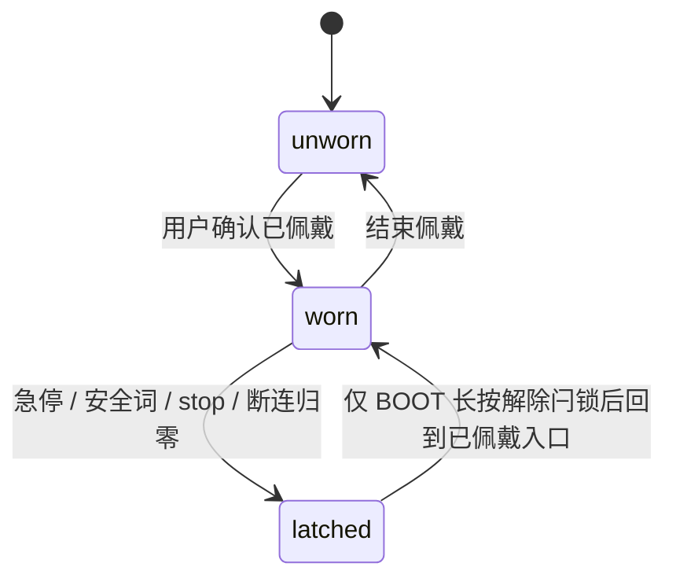
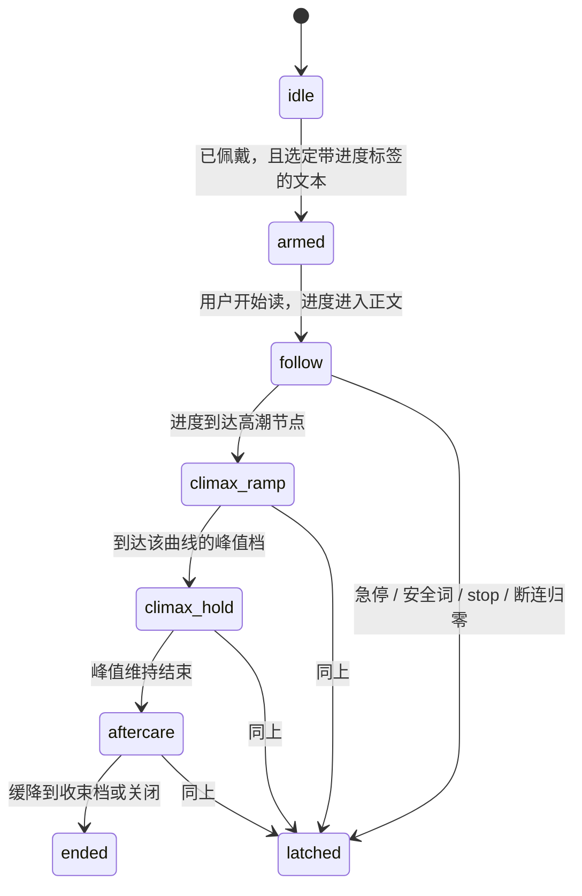

# Nascent Love 产品决策（2026-11-02～11-03）

> 状态：产品方向与实现优先级，供评审。不是协议变更，不改固件、不改 `protocol/contract.yaml`。
> 来源：2026-11-02～11-03 与 emo 的产品讨论纪要，整理进仓库。
> 安全口径以 [`architecture/产品架构.md`](architecture/产品架构.md)（架构综合 V1.4）为准。本文与 RFC 冲突时，安全不变量、停机路径和数据边界以 RFC 为准；本文只补充体验、分期和部署偏好。
> 相关规格：[`architecture/B层完整版技术文稿-双模型与偏好闭环.md`](architecture/B层完整版技术文稿-双模型与偏好闭环.md)、[`architecture/B层情景模式技术实现.md`](architecture/B层情景模式技术实现.md)、[`architecture/UI设计与用户旅程.md`](architecture/UI设计与用户旅程.md)。

确认的是方向和优先级。下面「仍开放」里的检测方式、档位表、模型和年龄核验机制，这次没有选定，不能从本文直接改协议或固件。

## 0. 这次明确不改的不变量

| 不变量 | 仍然是 |
| --- | --- |
| 本地急停 | 玩具侧 BOOT 键短按（量产为常闭拉环）在 ESP32 本地闭环，绕过 App 与 LLM |
| 无远程恢复 | 没有任何传输通道能投递 `resume`。`clearLatch()` 只允许由 BOOT 键的处理函数调用。停机后不自动回到停机前的档位 |
| 强度上限 | 常规档位 PWM 上限 90%；失控模式 15 分钟强制降回 2 档。阅读曲线和日 / 夜解锁都不能抬高这个上限 |
| 数据 | 音频即识别即丢弃，不上云。云端只收状态摘要。原始 12Hz 流不上行到剧本层 |
| 语义控制 | LLM 文本不得直接转成电机指令。Control 只出语义档，由本地安全总督和固件落地 |
| 玩具侧执行 | 验证期玩具侧不驱动电机，只模拟原按键。本文不新增电机驱动 |
| 商业红线 | 安全功能永不收费：基础报告、温度四逻辑、安全词、卫生指南、数据导出 / 删除 |
| 断连 | 手机断连后固件按既有策略归零，不在重连后自动回到原档 |

日 / 夜、阅读模式、换部署地域、freemium，都不构成上表的例外。

## 1. 产品形态与分期

- **MVP**：可穿戴震动 + AI 聊天陪伴。软件优先跑通。
- **后期**：可调弯曲 / 曲率硬件（找 G 点的硬件反馈）。当前不做。
- **策略**：先卖能用的，再打磨体验和硬件细节。

和 V1.4「上线路径」的关系：验证期单板 Demo、打磨期、合规与规模化的回滚口径不变（关掉云能力不得削弱急停、安全词和熔断）。本文把「阅读模式」放进 MVP 之后、曲率硬件之前的高优先级软件能力，不把曲率硬件提前。

## 2. 日 / 夜双时段体验

- **白天**：不穿戴设备。只有手机端 AI，做日常轻陪伴，包括学习监督一类非亲密场景。
- **夜晚**：穿戴之后才解锁震动，以及亲密 / 自用模式。
- **上下文**：夜晚会话应能关联「全天」陪伴上下文，而不是一夜一清空。

状态键是**未佩戴 / 已佩戴**，不是时钟。产品把白天定义为不穿戴、夜晚定义为穿戴后的使用窗口。白天如果穿上，按已佩戴处理；夜晚如果没穿，震动和亲密模式仍然锁着。

「解锁」只打开入口。它不是自动开机，不是同意跳过安全词，也不是解除停机闩锁。连接成功不等于已佩戴，更不等于可以出档。

全天上下文走既有的摘要和已授权记忆，不因此上传音频、对话原文或原始传感器流。

### 2.1 产品状态

| 状态 | 手机 AI | 震动与亲密 / 自用模式 | 上下文 |
| --- | --- | --- | --- |
| `unworn`（白天的默认） | 日常轻陪伴可用，含学习监督 | 锁着。不提供出档入口 | 当天陪伴可以记摘要，供之后的已佩戴会话读取 |
| `worn`（夜晚的默认） | 可进入亲密陪伴 | 入口解锁。出档仍走总督和固件 | 带上全天已授权上下文，不从零开始一夜 |
| `latched` | 不影响本地停机 | 不能由 App、云端或阅读曲线解开 | 停机事件只留摘要 |

从 `latched` 回来之后，设备不恢复停机前的档位。阅读模式只能从 `worn` 进入。

已佩戴如何判定，这次不锁定。实现时不能把「蓝牙已连接」或「页面打开」当成已佩戴。

## 3. 双 Agent（Chat / Control）

确认硬件加软件两条逻辑 Agent，和 V1.4 已有分工一致，这次是重申而不是新开一条控制路径：

| 角色 | 负责 | 不负责 |
| --- | --- | --- |
| Chat | 台词、情景、记忆候选 | 调档、停止、计时、恢复、删除 |
| Control | `hold` / `recommend` / `ask` 等控感语义 | 把自由文本变成电机指令；绕过总督；抬高安全上限 |

- 单 MCU（ESP32-S3）本地安全闭环。急停在本地。无远程 `resume`。
- LLM 文本不得直接转电机指令。
- Control 只出语义档，由本地安全总督和固件落地。
- 两个逻辑角色可以继续指向各自钉死的模型版本。禁止为了「追最新」把 Chat 和 Control 绑成一次静默升级。版本策略见 [模型运维](#model-ops)。

## 4. 宿舍友好「阅读模式」（高优先级软件能力）

用户可以静默阅读带标签的小黄文 / 情景文（例如 spank、SM 等标签），**不必回聊**。适合宿舍这类需要低调的场景：少语音交互，少 UI 操作。

震动强度由**预处理的场景进度曲线**驱动。少量离散档即可，不必按阅读过程实时细调。文到高潮节点的形状固定为三段：

1. **拉升**：快速升到这条曲线的峰值档。
2. **维持**：峰值维持。
3. **收束（aftercare）**：从峰值缓降。

曲线在开读之前就做好。播放时不再请模型把正文逐句译成电机指令。云端不可达时，本地 BLE、离线档位和这条预置曲线仍然可用（见 [后端](#backend)）。

档位只能落在现有设备协议已经允许的目标档里（`set_level` 的 0 或 1–9），并继续受 PWM 上限约束。具体哪一段对应哪一档，这次不锁定，避免在决策纪要里写出一套新的强度表。实现时走既有 `Governor` → `sendCommand()` → 固件，不新增指令，不把曲线播放器做成第二条下行路径。

默认不走 Chat。Control 不在这条默认曲线的回路里。若以后允许 Control 对曲线提出偏离，仍然只能是语义档，并且要重新经过总督；那不是这次的范围。

安全词、BOOT 急停、断连归零、停机闩锁的优先级高于曲线。曲线不能在闩锁期间继续升档，也不能在用户停机后自己恢复。

### 4.1 无对话震动曲线

进度只驱动「现在该落在哪一档」。档的个数少，切换跟着预处理标签走，不跟着语音识别或逐句生成走。

| 段 | 进度 | 档位形态 |
| --- | --- | --- |
| `follow` | 场景正文 | 少量离散档，随预处理标签切换 |
| `climax_ramp` | 高潮节点开始 | 快速升到这条曲线的峰值档 |
| `climax_hold` | 峰值 | 保持峰值档 |
| `aftercare` | 收束 | 缓降 |
| `ended` | 读完或用户结束 | 收到收束档或关闭，不自动进入下一次 |
| `latched` | 安全停机 | 曲线中止。只有 BOOT 长按能解除闩锁，且不恢复峰值 |

`armed` 只表示曲线已就绪、入口已开，电机仍应停着，直到用户开始读并且进度进入正文。开始阅读是用户动作，不是模型动作。

## 5. 内容与人设

- 支持小黄文、轻度 Dom、SM / SP。较温和的选项（纪要里举的例子是憋尿）做成可配置项，而不是默认打开。
- 用户可自定义，可导入自己的情景文本（纪要中的「个人 PO 文」）。
- **安全优先**。安全词、急停、强度上限、内容审核边界不变。导入文本不能关闭这些边界，也不能把正文直接变成下行指令。
- 人设以文本 + 语音为主，不做视频。
- 自定义角色，以及用户自己的 XP。可以有「作业 / 任务」式的轻度 Dom 互动。任务是叙事，不能改安全上限，不能阻止停止，不能用挽留话术把人留在会话里。
- TTS：多语音包可选。语音包选择不改变安全词通道：玩具侧安全词仍在 ESP32 本地，即识别即丢弃。

## 6. 后端与模型部署

- **海外自建后端优先**，用来承载 NSFW / 少审查的开源模型。国内托管的 Qwen 等 API 对成人向内容过滤风险高，不适合作为亲密剧本的主路径。
- 换托管地是为了让产品已经允许的成人剧本不要被托管 API 的成人策略整段拒答。Nascent 自己的安全规则层、年龄门禁、话术黑名单、禁止挽留、禁止文本直接转电机指令，都不因模型少审查而放宽。
- 前端可以在国内，后端在海外。
- 弱网降级：本地 BLE、离线档位、预置阅读曲线仍然可用。降级不是解除闩锁的理由，也不是重连后自动恢复档位的理由。
- CDN / 中继如果要碰成人内容，选型要单独审，不能默认套用通用公共 CDN 的条款。
- **年龄门禁必须做实**，见 [年龄门禁](#age-gate)。这是合规项，不是体验可选项。

和 V1.4 的关系：验证期逻辑别名仍是 `nascent-chat-9b` / `nascent-control-9b`，当前 RFC 把它们锁在 `Qwen/Qwen3.5-9B`。本文记录的是亲密剧本主路径的部署偏好，**不在这次把锁换掉**。真要换模型、换地域或改用自建权重，另走架构评审，并满足 [模型运维](#model-ops) 的版本钉死和回滚。

## 7. 商业化

- 先免费试用 / freemium，再订阅付费。
- 「安全功能永不收费」保持，和架构里的商业不变量是同一条：基础报告、温度四逻辑、安全词、卫生指南、数据导出 / 删除永久免费。
- 阅读模式、日间陪伴、亲密剧本里哪些能力进免费档、哪些进订阅，这次没有划线。划的时候不能把急停、安全词、强度上限、卫生指南或数据删除放进付费墙。

## 8. 数据与错误上报

- **前端不做**面向优化的重遥测。隐私优先，和「云端只收状态摘要」一致。
- 客户端错误可以上报后端（Sentry 一类）。上报的是错误类别和排障所需的技术上下文。
- 错误日志只存摘要和错误，不存对话原文，不存录音，不存原始传感器波形。这条和模型运维第 6 条是同一条。
- **默认不要自动把错误弹给用户**，除非产品明确做了错误反馈 UI。没有那块 UI 时，失败沿用现有的本地安全回退（空动作、档位不变、停止不依赖模型），而不是弹一张未设计的报错。

## 9. 模型运维 checklist

亲密剧本和 Control 建议都按这份清单运维。它不新增模型权限。

1. Chat / Control **版本钉死**，禁止静默追最新。
2. 主备双活 / 跨区 failover。切换副本不重置设备侧闩锁、档位和模式。
3. 健康检查：延迟、拒答率、空回复。超过阈值告警。
4. 灰度：新模型先大约 5% 用户，看急停率、差评、完成率，再全量。
5. **提示词 / 安全层与模型权重分开发版**。改安全规则层不是一次模型热更新。
6. 成本看板按会话计。日志只存摘要和错误，不存原文 / 录音。
7. 一键回滚到上一稳定版。
8. 自建 GPU：盯显存、队列、OOM。托管 API：盯额度、地区、内容策略变更。内容策略收紧到亲密剧本大面积拒答时，按第 7 条回滚或切到已评审的备路，而不是在客户端放宽审核。

## 10. 年龄门禁

年龄门禁必须做实，是重要合规项，对应架构 RFC 已引用的《人工智能拟人化互动服务管理暂行办法》：强制年龄验证，禁止向未成年人提供虚拟伴侣。

当前 UI 旅程稿里的「滑块轻量确认」只是既有交互草稿，**不算**这次要求的实门禁。核验机制（做到哪一种证明）这次没有选定。选定之前，不能把滑块写成已经合规。

门禁要挡住未成年人进入伴侣和亲密模式。它不替代安全词、急停或强度上限。用户也不能在人设或导入文本里把年龄门槛关掉。

## 仍开放

| 项 | 这次只定了什么 | 还没定 |
| --- | --- | --- |
| 已佩戴判定 | 状态键是未佩戴 / 已佩戴；连接成功不等于已佩戴 | 用哪一个传感器或用户确认，不在本文 |
| 阅读曲线档位表 | 少量离散档；高潮是拉升 → 维持 → aftercare 缓降 | 每一段对应的具体档位和时长 |
| 亲密剧本模型 | 偏好海外自建、少审查开源模型；国内托管 Qwen 一类 API 不适合当主路径 | 哪个权重、哪个地域。V1.4 的别名锁这次不动 |
| 年龄门禁机制 | 必须做成能拦住未成年人的实门禁 | 具体核验方式 |
| CDN / 中继 | 碰成人内容要单独选型 | 供应商 |
| freemium 划线 | 先免费试用再订阅；安全功能永不收费 | 阅读模式和亲密剧本的免费边界 |

## 文档位置

本文是 2026-11 产品决策的仓库副本。架构 RFC 的目标、非目标、上线路径，以及 B 层目标、UI 旅程里的年龄验证、日常循环和订阅，只交叉引用这里，不把安全不变量改写一遍。
